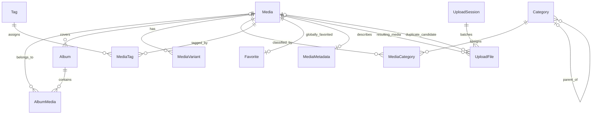

# Album Manager schema

The initial MVP schema is defined in `apps/api/prisma/schema.prisma` and created by
`20261008040000_initial_album_manager`. PostgreSQL is the persistence layer;
handwritten runtime and configuration code remains JavaScript.

The `20261008150000_media_list_indexes` migration adds the composite
`(deleted_at, original_filename, id)` index for filename keyset pagination and
a partial `(taken_at DESC NULLS LAST, id DESC) WHERE deleted_at IS NULL` index
for newest-taken-first gallery queries. The partial/null-ordering index is maintained
in SQL because Prisma schema index syntax cannot express this ordering and predicate.
The existing ascending taken-date index serves oldest-first queries with nulls last.
See [Media list API](../api/MEDIA.md) for query and cursor semantics.

## Identity and ownership

This is a single-user application. There is no User model, user ID, implicit
current user, or authentication prerequisite. Favorite is global: a media item has
at most one favorite row. A future authentication migration may add a user relation
and replace unique `mediaId` with unique `(userId, mediaId)` after explicitly assigning
existing favorites to an owner. Core functionality must not assume that phase exists.

## Models and relationships

| Model / table                               | Purpose and relationships                                                                                                                                                                            |
| ------------------------------------------- | ---------------------------------------------------------------------------------------------------------------------------------------------------------------------------------------------------- |
| Album / `albums`                            | Named collection with unique slug, optional description, PRIVATE/PUBLIC visibility, optional cover, and soft deletion.                                                                               |
| AlbumMedia / `album_media`                  | Many-to-many album membership. Unique `(albumId, mediaId)`; nonnegative position and creation time. Removing membership never deletes media.                                                         |
| Media / `media`                             | Shared IMAGE/VIDEO identity, original filename, MIME type, extension, byte size, processing status, optional dimensions/checksum/capture time, timestamps, and soft deletion. Contains no `albumId`. |
| MediaVariant / `media_variants`             | Stored ORIGINAL, OPTIMIZED, PREVIEW, THUMBNAIL, or BLUR_PLACEHOLDER asset belonging to one media item. Unique `(mediaId, type, format, name)` and globally unique storage key.                       |
| Category / `categories`                     | Hierarchical taxonomy using nullable `parentId`, a self-reference, globally unique slug, and creation/update times. Root categories have no parent.                                                  |
| MediaCategory / `media_categories`          | Many-to-many media/category assignment; unique `(mediaId, categoryId)`.                                                                                                                              |
| Tag / `tags`                                | Flat taxonomy with globally unique slug and creation/update times.                                                                                                                                   |
| MediaTag / `media_tags`                     | Many-to-many media/tag assignment; unique `(mediaId, tagId)`.                                                                                                                                        |
| Favorite / `favorites`                      | Global single-user favorite with unique `mediaId` and creation time.                                                                                                                                 |
| UploadSession / `upload_sessions`           | Batch lifecycle, creation time, optional completion time, and many upload files.                                                                                                                     |
| UploadFile / `upload_files`                 | Per-file lifecycle and source metadata, optional staging storage key, resulting media, duplicate candidate, processing admission checkpoint, safe failure message, and creation/update times.        |
| MediaMetadata / `media_metadata`            | Optional one-to-one extracted metadata; unique `mediaId`. All camera/EXIF fields are nullable because extraction is incomplete or absent for many files.                                             |
| ApplicationSetting / `application_settings` | Global unique key and required JSONB value, with update time. Stable persistence target for a future settings repository/service used by workers and services.                                       |

ApplicationSetting is independent of identity, albums, and uploads.

## Keys, values, and timestamps

Every model has a UUID primary key with Prisma-generated `uuid()`; relationship
fields use PostgreSQL UUID. Join models also have surrogate UUIDs for stable cursors,
plus unique relationship pairs. Favorite and MediaMetadata retain UUID identities
and unique media foreign keys. UUID defaults are generated by Prisma, not PostgreSQL;
external SQL writers must supply IDs explicitly.

JavaScript/Prisma names are camelCase/PascalCase. SQL tables, columns, and enum type
names map to snake_case. Timestamps are UTC instants stored as `timestamptz(3)`.
`createdAt` defaults to database `now()`; `updatedAt` is maintained by Prisma.
External writers must maintain update timestamps. Append-only association, favorite,
and variant records need creation time only. Session completion records have
`completedAt`; settings require only `updatedAt` per their contract.

All byte sizes use PostgreSQL bigint / JavaScript BigInt, avoiding the 2 GB limit
of signed 32-bit integers. Future API mappers must serialize BigInt deliberately,
for example as a decimal string. Zero-byte files are representable; upload validation
may reject them separately. Dimensions and aspect ratio remain null until measured.
Metadata stores focal length in millimeters, aperture as an f-number, ISO as an
integer, shutter speed as source text (for example `1/250`), coordinates as decimal
degrees, and source metadata as optional JSONB. Normalize metadata before persistence.

Variant format is a normalized lowercase format name, for example `jpeg`, `webp`,
or `mp4`. Its MIME type is derived by the storage/media service, not stored here.
Quality is optional and, when supplied, between 1 and 100. Multiple formats of the
same variant type are supported. Services must keep ORIGINAL immutable and create
only the intended original asset; the unique named variant identity prevents duplicate
renditions but does not enforce one ORIGINAL across different formats.

## Lifecycle values

| Field                | Values / default                                                                         |
| -------------------- | ---------------------------------------------------------------------------------------- |
| Album.visibility     | PRIVATE (default), PUBLIC                                                                |
| Media.type           | IMAGE, VIDEO; explicitly supplied                                                        |
| Media.status         | PENDING (default), PROCESSING, READY, FAILED                                             |
| UploadSession.status | REGISTERED (default), UPLOADING, PROCESSING, COMPLETED, FAILED, CANCELLED                |
| UploadFile.status    | REGISTERED (default), UPLOADING, PROCESSING, DUPLICATE_PENDING, READY, FAILED, CANCELLED |

An upload can enter DUPLICATE_PENDING with a nullable `duplicateOfMediaId` candidate
reference; acceptance may link `mediaId` to the existing media. The two references
have distinct relation names and indexes. `storageKey` is nullable before storage
acceptance and is not unique because an accepted duplicate can reference an existing
object. Session and file status transitions, aggregate completion, retries, and
cancellation are future service responsibilities; enum membership alone does not
validate transitions. Persist safe upload errors, never raw credentials or stack traces.

## Checksum and uniqueness

Checksum is nullable while processing. Once available it is a lowercase,
64-character SHA-256 digest of original bytes. Migration
`20261008120000_media_processing` replaces the unique checksum index with
`(checksum, createdAt, id)`, allowing explicitly accepted duplicates to retain
separate Media identities and originals. Duplicate detection chooses the oldest
active match deterministically and excludes the current Media. The worker holds a
transaction advisory lock across detection and checksum reservation to serialize
competing uploads; the checksum index alone does not enforce duplicate policy.
Soft-deleted records are excluded from active detection. The legacy lookup can
include them deliberately; no worker silently restores or purges them.

Album, category, and tag slugs are globally unique within their own tables. Album
slugs stay reserved during soft deletion. Services normalize slugs and use unique
constraints to resolve races; display names are not unique.

## Index strategy

B-tree index prefixes support the intended filters; unique indexes already cover
single-row lookup and leading foreign keys, so redundant indexes are omitted.

- Album: cover foreign key, `(deletedAt, createdAt, id)`, and
  `(deletedAt, visibility, createdAt, id)` for active collection lists.
- Media: active lists ordered by creation or capture time, and active status/type
  filters ordered by `(createdAt, id)`. The `(checksum, createdAt, id)` index supports deterministic duplicate lookup.
- AlbumMedia: unique album/media pair; album/position/ID and album/creation/ID ordering;
  reverse `(mediaId, albumId)` lookup for a media item's albums.
- MediaVariant: unique media/type/format supports media's variants; storage-key uniqueness.
- Category: parent/name/ID for tree children and creation/ID listing; unique slug.
- Tag: creation/ID listing and unique slug.
- MediaCategory and MediaTag: unique media/taxonomy pair plus reverse taxonomy/media index.
- Favorite: unique media lookup and creation/ID ordering for favorite lists.
- UploadSession: status/creation/ID queue lookup and creation/ID history.
- UploadFile: session/status/creation/ID, global status/creation/ID, creation/ID history,
  resulting-media lookup, and duplicate-candidate lookup.
- MediaMetadata: unique media lookup. ApplicationSetting: unique setting-key lookup.

Active media queries use `deletedAt: null`; timestamps are ordered with ID as a
stable tie-breaker. `takenAt` is nullable, so future repositories/cursors must choose
and preserve explicit null ordering. These indexes target active lists; unrestricted
administrative history queries may need different indexes when introduced.

## Deletion and integrity

Soft deletion applies to Album and Media only. It does not fire foreign-key actions:
repositories must exclude deleted entities and related media from normal reads.
Taxonomies, upload bookkeeping, settings, and associations are hard-deleted only
through an explicit service action; removing favorites means deleting their row.

Physical deletion behavior is explicit on every relation:

- Deleting an album cascades only its AlbumMedia rows, never the media or stored files.
- MediaVariant restricts media deletion until a storage-aware cleanup service removes
  the associated objects/variant rows deliberately. SQL cascades cannot delete objects.
- After variants are removed, media deletion cascades its membership, taxonomy joins,
  favorite, and metadata; album covers and upload media/duplicate references become NULL.
- A category with children cannot be deleted until children are moved or removed.
  Category/tag deletion removes only their assignment rows, never media.
- A session with files cannot be deleted until files/staging objects are handled explicitly.
- Foreign-key updates cascade UUID changes, although IDs should remain immutable.

The migration adds SQL CHECK constraints for nonnegative byte sizes/positions,
positive known dimensions and finite aspect ratio, valid quality and SHA-256 digest,
positive finite focal length/aperture and positive ISO, latitude/longitude bounds,
completion no earlier than creation, and a category not parenting itself.
These SQL constraints are not represented by Prisma schema syntax; preserve them
in later migrations and run database integration tests after changing the schema.

Multi-level category cycles require service validation (including concurrent moves
under appropriate transaction locking). An album cover must refer to a live media
member of that album; the database enforces existence, while service transactions
must enforce membership and clear/update covers when membership is removed.
No current-user checks are involved. No APIs or business services are added here.

Settings access must go through an injected repository and settings service so
workers can consume validated values/defaults without knowing persistence details.
Controllers must never query ApplicationSetting directly. The schema establishes
the persistence contract without inventing setting keys or values.

## Migration and verification

Run `npm run db:deploy` to apply the initial migration, then `npm run db:generate`.
Use `npm run db:migrate -- --name <change>` for subsequent local development changes.
The seed foundation stays data-free. Never edit this migration after applying it.

Database integration tests run the migration inside a transaction and an isolated
schema, exercise constraints and relationships, then roll back without touching
application tables. Run `npm run test:database --workspace @album-manager/api`
against configured PostgreSQL. Default `npm test` remains database-independent.
